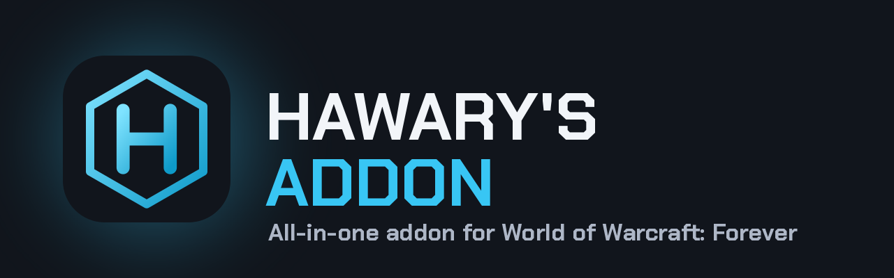

<p align="center"></p>

# Hawary's Addon

**One addon for World of Warcraft: Forever** that brings together what the most popular addons do, with one clean Hawary look and one settings window.

- **Game:** World of Warcraft: Forever, client 1.60.1, `## Interface: 16001`
- **Version:** 0.3.0 (Phase 3: Professions, Market, Alts & Gold)
- **License:** GPL-3.0-or-later. Free forever, code fully visible, as Blizzard's add-on policy requires.

## What's in it

| Module | Like | What it does |
|---|---|---|
| **Journey & Guide** | Zygor, RestedXP, Questie, NAG Journey, Overwolf stats | A floating **step-by-step guide window** with the current step, its objectives and the next steps. A big **direction arrow** with distance. **Blizzard's own map pin and in-world marker** for the current step. **Auto Journey** builds your route from your own quest log (finished quests first, then the nearest objectives). **Import step guides** ([format](docs/GUIDE-FORMAT.md)). **Session stats** (XP/hour, time to level). Level-up notice. Optional quest automation: off by default, Shift pauses it, never in combat. |
| **Gear & Upgrades** | Pawn, GearQuest, NAG Journey | Stat weights for your class and spec. Tooltip shows `+12% upgrade` or `-5% vs equipped`, plus the exact item level and item ID. Green arrows on upgrades in your bags. **Marks the best quest reward** (your biggest upgrade, or what sells for the most) and can pre-select it. You still click Complete. Notices when you loot an upgrade. |
| **Bags** | Baganator, Altoholic | Remembers every character's bags, bank and gear. Item tooltips show who has how many (bags / bank / worn). Total gold across characters on the Home page. |
| **Professions** | SkillUp, Profession Shopping List, ForeverProfit | Profession ranks with progress bars. The recipes you know, **ranked by profit** with auction prices (unknown prices stay "?", never free). A **shopping list** that checks reagents against every character's bags and bank, with the cost of what's missing. Reagent tooltips show "have / need". |
| **Market** | Auctionator | Remembers **auction house prices** from your normal browsing and searches, plus a **Hawary Scan** button for a full scan (once per 15 min, read in chunks so the game doesn't freeze). Tooltips show the AH price and its age. Prices are kept per auction house. It **never buys, bids or posts**. |
| **Alts & Gold** | Altoholic, Overwolf character snapshot | Every character's level, item level, gold, professions and last login. A **gold chart** (7–90 days) and an **item search across all your characters**. |
| **Quality of Life** | Leatrix Plus, Leatrix Maps, BlizzMove | Auto repair (guild funds optional), sell junk, instant loot, accept invites from friends & guild, decline duels, max camera distance, coordinates on the minimap and world map, drag Blizzard windows. |

The **Home** dashboard shows your character, gold across all characters, average item level, upgrades waiting in your bags, every module's on/off switch and what's coming next.

**Two themes**, switchable in General:
- **Hawary Neon** (default): dark navy, neon cyan, the hex-H logo, rounded cards and a glow, like the Hawary's Bot dashboard.
- **Blizzard + Hawary**: Forever's own gold-trim dialog windows and buttons with Hawary accents.

Everything is also in Blizzard's own **Options → AddOns → Hawary's Addon** menu.

## Coming next

Dungeons (with an Overwolf-style adventure planner) · Discovery (your own map layer: rares, herbs and ore you found, books) · "What now?" button · Journey Diary · Talents & Training · Macro Helper (normal Blizzard macros only).

What we learned from the changelogs of Leatrix, Questie, ClassicUI Forever, NaowhForever, SkillUp, BlizzMove and the Overwolf apps is in [docs/RESEARCH.md](docs/RESEARCH.md).

## Safe to use: no bannable features

Hawary's Addon follows [Blizzard's UI Add-On Development Policy](https://us.forums.blizzard.com/en/wow/t/ui-add-on-development-policy/24534) and the Midnight/Forever combat rules. See [docs/SAFETY.md](docs/SAFETY.md).
- No combat automation and no reading of hidden combat data. No one-button rotation or sequence macros.
- No advertising, no links to shops or services in-game, no donation requests. Free, open code.
- Only Blizzard's own addon API, the same calls Blizzard's UI makes. Nothing outside the game client.

## Install

1. Download this repository (green **Code** button → **Download ZIP**), or grab a release.
2. Copy the **`HawarysAddon`** folder into
   `World of Warcraft\_forever_\Interface\AddOns\`
3. Start the game (or `/reload`). Make sure **Hawary's Addon** is ticked in the AddOns list.

## Use

| Command | What it does |
|---|---|
| `/ha` | open or close the window (also `/hawary`) |
| `/ha guide` | show or hide the guide window |
| `/ha options` | Blizzard's options menu for the addon |
| `/ha journey` · `/ha gear` · `/ha bags` · `/ha qol` · `/ha general` | open a page |
| `/ha stats` | print the raw stats of the item under your mouse (helps tune stat weights) |
| `/ha version` | show the version |

Minimap button: **left-click** opens the window, **right-click** opens the options, **drag** moves it.

## For developers

```
HawarysAddon/          the addon folder that goes into Interface\AddOns
  HawarysAddon.toc     load order, Interface 16001
  Locales/enUS.lua     every visible string (English base, others fall back to it)
  Core/                Util (pure helpers), Init (modules/events/saved vars), Theme (themes + widgets), UI (window, menus, minimap, toasts)
  Modules/             JourneyData (pure guide/route logic), Journey, JourneyUI, GearData (pure scoring), Gear, Bags, QoL
  Media/               logo, mark, UI shape textures, Chakra Petch font (OFL)
brand/                 logo + banner (source in tools/make_brand.py)
docs/                  API notes, safety rules, requirements
tests/run.lua          unit tests + smoke test with a mocked WoW API
tools/check.py         syntax check + "every global exists in the Forever API" check
```

```bash
luajit tests/run.lua          # unit + smoke tests
python3 tools/check.py        # Lua 5.1 syntax + Forever API globals
python3 tools/make_brand.py   # rebuild logo, textures, font and banner
```

APIs were checked against Blizzard's Forever UI source (`Gethe/wow-ui-source`, branch `forever`, build 1.60.1.70888) and the Forever API reference for build 1.60.1.70755. See [docs/API-NOTES.md](docs/API-NOTES.md).

## Credits

- Chakra Petch font: SIL Open Font License (`HawarysAddon/Media/OFL-ChakraPetch.txt`).
- Feature ideas from the addons listed above. No code was copied from them.
